<div align="center">


# WhisperX Transcriber

**Offline AI transcription for Windows.**
Every word timed · every speaker named · nothing uploaded

**Works with** MP3 · WAV · M4A · FLAC · OGG · OPUS · AAC · WMA · MP4 · MKV · MOV · AVI · WEBM · and more

[](LICENSE)
[](https://github.com/ibrahimqureshae/whisperx-transcriber/releases/latest)
[](#the-proof-private-free-fast)
[](https://github.com/ibrahimqureshae/whisperx-transcriber/releases/latest)
[](#feed-ai-the-words-not-the-pixels)
[](#the-proof-private-free-fast)
[](https://github.com/ibrahimqureshae/whisperx-transcriber/stargazers)

[**Download for Windows**](https://github.com/ibrahimqureshae/whisperx-transcriber/releases/latest)
&nbsp;&nbsp;·&nbsp;&nbsp;
[The proof](#the-proof-private-free-fast)
&nbsp;&nbsp;·&nbsp;&nbsp;
[For AI](#feed-ai-the-words-not-the-pixels)
&nbsp;&nbsp;·&nbsp;&nbsp;
[See it in action](#see-it-in-action)
&nbsp;&nbsp;·&nbsp;&nbsp;
[▶ Watch the podcast](https://ibrahimqureshae.github.io/whisperx-transcriber/#podcast)
&nbsp;&nbsp;·&nbsp;&nbsp;
[How it compares](#how-it-compares-to-the-whisperx-command-line)
&nbsp;&nbsp;·&nbsp;&nbsp;
[Website](https://ibrahimqureshae.github.io/whisperx-transcriber/)
&nbsp;&nbsp;·&nbsp;&nbsp;
[Report a bug](https://github.com/ibrahimqureshae/whisperx-transcriber/issues)
&nbsp;&nbsp;·&nbsp;&nbsp;
[❤️ Support](#support-the-project)

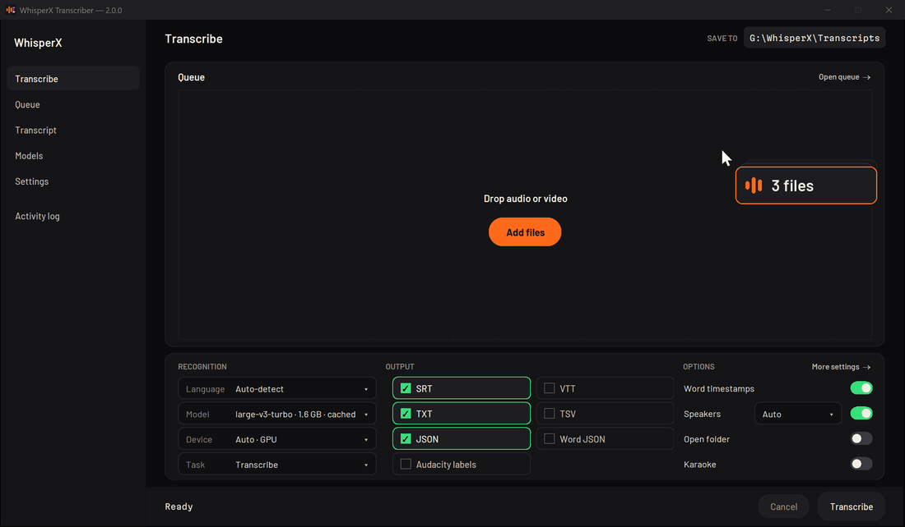

<sub>Recorded from a real run on a laptop RTX 4060: a three-voice podcast (synthetic voices), a German lecture and an Urdu interview, transcribed with speakers and word timing. The waiting is sped up.</sub>

</div>

## Download WhisperX Transcriber

<div align="center">

<a href="https://github.com/ibrahimqureshae/whisperx-transcriber/releases/latest/download/WhisperXTranscriber.zip">
  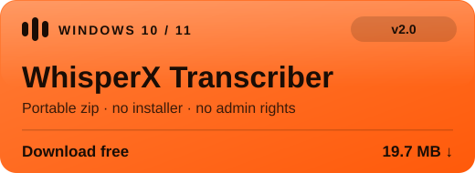
</a>

**Unzip, run `WhisperXTranscriber.exe`, done.** No installer, no admin rights, no account.

The first launch downloads the speech engine once (about 1 GB for CPU, 2 to 3 GB with NVIDIA GPU support).
After that, everything runs offline.

[❤️ Sponsor on GitHub](https://github.com/sponsors/ibrahimqureshae) ·
[☕ Buy me a coffee](https://buymeacoffee.com/mibrahim99) ·
[💳 PayPal](https://www.paypal.me/mibrahimqr) ·
[⭐ Star the repo](https://github.com/ibrahimqureshae/whisperx-transcriber)

[All release files](https://github.com/ibrahimqureshae/whisperx-transcriber/releases/latest) ·
[What's new in 2.0](#whats-new-in-20) ·
[Website](https://ibrahimqureshae.github.io/whisperx-transcriber/)

</div>

---

## Why I built it

I built WhisperX Transcriber for myself, to automate my own video workflows. I wanted to drop in a batch of recordings and get back timed, speaker-labelled transcripts and subtitles, without uploading anything and without babysitting a terminal.

The usual options didn't fit. Cloud services bill by the minute and keep a copy of your recording. The excellent [WhisperX](https://github.com/m-bain/whisperX) engine expects you to wrangle Python, CUDA wheels, FFmpeg and a Hugging Face token before it prints a single word.

So I wrapped WhisperX in an app that does the whole job. Drop in an interview, a lecture or a podcast and get back a transcript where every word has its own timestamp and every line knows who said it. Rename the speakers, fix the doubtful words, and export subtitles straight into your editor. It runs entirely on your machine, and after the first launch it never needs the internet again.

It made my own workflow faster, so I'm releasing it for everyone to use, free.

---

## The proof: private, free, fast

**Nothing leaves your PC.** The audio is decoded, transcribed, aligned and split by speaker on your own hardware. Turn on **Offline only** in Settings and it uses only the models already on your disk.

**It costs nothing, at any volume.** Here is the same 100 hours of interviews three ways, at list prices checked on 26 October 2026:

| 100 hours of audio | Cost | Where your audio goes |
|---|---:|---|
| Human transcription ([Rev](https://www.rev.com/pricing), $1.99 per minute) | $11,940 | Uploaded to a vendor |
| Cloud AI subscription ([Otter Business](https://otter.ai/pricing), 6,000 imported minutes a month) | $30 a month | Uploaded to a vendor |
| **WhisperX Transcriber** | **$0** | **Stays on your PC** |

<div align="center">
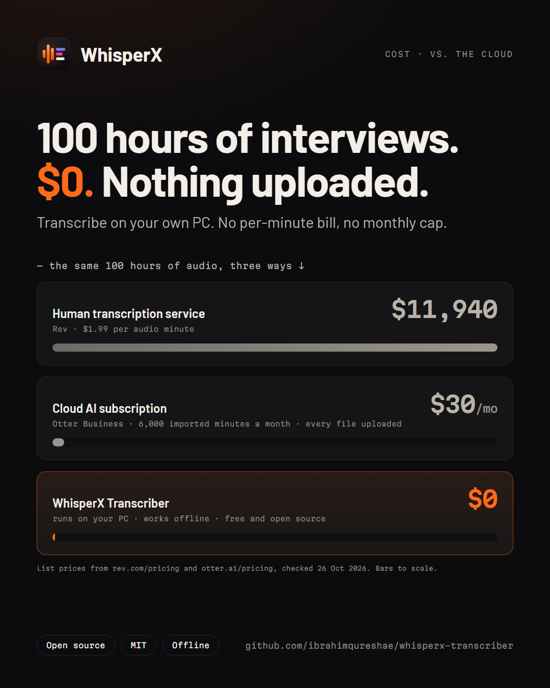
</div>

**It's fast on ordinary hardware.** Measured through the app on a 10-minute English recording, on a laptop with an RTX 4060 (8 GB):

| Model | Speakers | 10 minutes of audio took | Speed |
|---|---|---:|---:|
| `large-v3-turbo` | off | 33 s | 18× real time |
| `large-v3-turbo` | on | 2 min 25 s | 4× real time |
| `large-v2` | on | 2 min 39 s | 3.8× real time |

Times include loading the model and timing every word. Speaker identification runs on the CPU, so it adds the most time. Without an NVIDIA GPU the app runs on the CPU, where the `small` model is the sensible choice.

<div align="center">

[**Download for Windows**](https://github.com/ibrahimqureshae/whisperx-transcriber/releases/latest)
&nbsp;·&nbsp; Free &amp; MIT-licensed &nbsp;·&nbsp; No account, no cloud, no token

</div>

---

## Feed AI the words, not the pixels

More and more recordings end up in an AI chat: summarise this meeting, find where the guest talks about pricing, turn this lecture into notes. Models like Gemini take video directly, but video is an expensive way to spend tokens. A timestamped transcript carries the same words, the same timing and the same speaker names at a fraction of the size.

- **You pay for frames, not words.** Gemini reads a video as one frame a second plus the audio, about 263 tokens per second at default resolution. A talking head doesn't need 3,600 frames an hour.
- **Audio alone is still heavy.** Even audio-only costs 32 tokens a second, about 115,000 tokens an hour.
- **Text is compact.** An hour of conversation is roughly 9,000 words. As SRT, with every timestamp and speaker name, that's about 30,000 tokens.
- **Timestamps keep it useful.** The model can still answer "where did they say that?" and cite the minute.
- **It compounds.** Every follow-up question re-reads the context, so the saving repeats on every call.

| One hour of a talk or interview | Tokens | Share of a 1M-token context |
|---|---:|---:|
| Video into Gemini, default resolution | ~947,000 | 95% |
| Video, low resolution | ~360,000 | 36% |
| Audio only | ~115,000 | 12% |
| **WhisperX Transcriber SRT** | **~30,000** | **3%** |

That's about **30× lighter than the video**: a million-token context holds over 30 hours of transcripts, or one hour of video. It works best when the words carry the content, as in interviews, meetings, lectures and podcasts. If the slides or on-screen action matter, send those few frames alongside the transcript.

<div align="center">
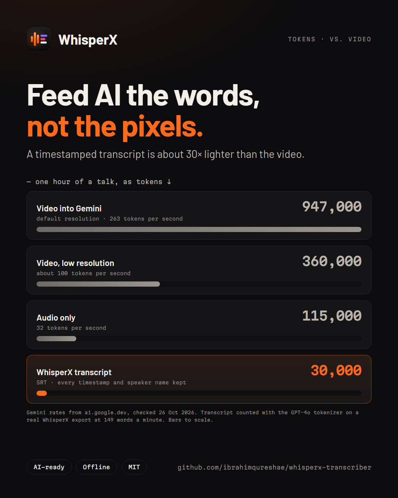
&nbsp;&nbsp;
<a href="https://ibrahimqureshae.github.io/whisperx-transcriber/#podcast"></a>
<br>
<sub>▶ <b>The WhisperX Podcast, ep. 1: "Too many tokens"</b> · <a href="https://ibrahimqureshae.github.io/whisperx-transcriber/#podcast">watch it with sound</a></sub>
</div>

<sub>Gemini rates from Google's [token](https://ai.google.dev/gemini-api/docs/tokens) and [video understanding](https://ai.google.dev/gemini-api/docs/video-understanding) docs, checked 26 October 2026. Transcript size counted with OpenAI's o200k tokenizer on a real export of the demo podcast (149 words a minute), scaled to one hour.</sub>

---

## Key features

| | |
|---|---|
| 🔒 **Private by design** | Your audio never leaves your machine. No cloud, no API key, no account, no telemetry. |
| 🗣️ **Speakers, named** | Each speaker gets a coloured lane. Type a name once and it appears in every export. No token, no sign-up. |
| ⏱️ **Every word timed** | Word-level timestamps for subtitles, search and editing, not just sentence blocks. |
| 🌍 **99 languages** | Auto-detects the language. Right-to-left scripts like Urdu, Arabic and Persian read in the right order. |
| 🧾 **Batch queue** | Drop a stack of files or a whole folder. They run back to back while you do something else. |
| 🔎 **Review, then export** | Click a line to jump the timeline, find any word, see the doubtful words underlined, re-export in one click. |
| 📦 **7 export formats** | SRT, VTT, TXT, TSV, JSON, per-word JSON and Audacity labels. |
| 🖥️ **No terminal, ever** | Portable app. Unzip, run, and a one-time wizard installs the engine for your GPU or CPU. |
| 🤖 **AI-ready** | Timestamped transcripts are about 30× lighter than video for ChatGPT, Gemini or any other model, and keep who said what and when. |
| 🔁 **Offline forever** | After the first setup, every transcription works with the Wi-Fi off. |

---

## What's new in 2.0

The biggest update since the first release. If you last tried 1.2, this is a different app.

- **A new home.** Five screens (Transcribe, Queue, Transcript, Models and Settings) in a dark, audio-workstation design, with a new icon to match.
- **Speaker identification with no blockers.** It now runs on open models that download by themselves, about 34 MB. The Hugging Face token and model terms are gone.
- **Transcript screen.** Speaker lanes on a timeline, click-to-jump lines, Find, doubtful words, speaker rename and one-click re-export.
- **Batch queue with drag and drop.** Every file gets its own waveform and a seven-step progress track.
- **Right-to-left done right.** Urdu, Arabic, Persian and Pashto read in order, with English words and numbers inside them kept intact.
- **Sturdier everywhere.** GPU memory back-off on 8 GB cards, instant Cancel, crash-safe settings, and a setup wizard that handles the newest NVIDIA drivers.

The full list is in the [CHANGELOG](CHANGELOG.md).

---

## Who it's for

🎙️ **Journalists**: transcribe source interviews without handing the audio to anyone

🎓 **Researchers and students**: batch-process lectures, focus groups and fieldwork, and keep participant data on your own machine

📹 **Podcasters and video creators**: speaker-labelled transcripts and subtitles for YouTube, TikTok and Reels

📝 **Translators**: a timestamped transcript in the original language, in 99 languages

🤖 **AI and RAG builders**: turn meetings, videos and podcasts into compact, timestamped text any model can read, without uploading the audio

🔒 **Anyone with sensitive recordings**: meetings, oral histories, family archives. Nothing is ever uploaded.

---

## See it in action

**01 · Drop.** Drag in an interview, a lecture, a stack of files or a whole folder. Each file shows its own waveform straight away.

<div align="center">
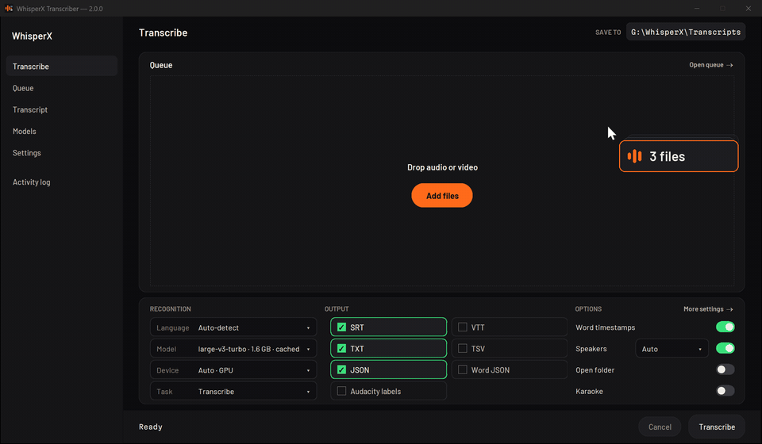
</div>

**02 · Transcribe.** Press Transcribe and the queue runs back to back. Seven dots per file show each step, from loading the model to naming the speakers. The language is detected for you: English, German and Urdu here.

<div align="center">
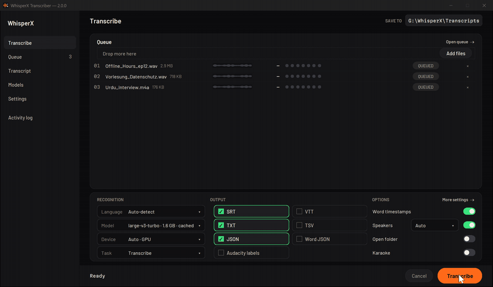
</div>

**03 · Name the speakers.** Each voice gets its own lane. Type a name and it replaces the speaker label everywhere, exports included. Click any line and the timeline jumps there.

<div align="center">
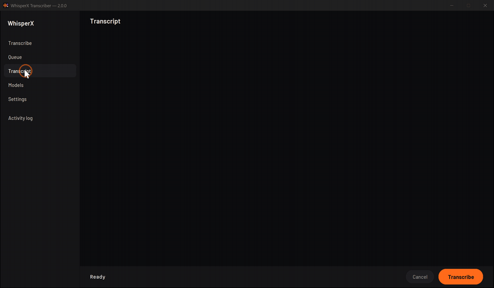
</div>

<div align="center">
<a href="https://ibrahimqureshae.github.io/whisperx-transcriber/#podcast">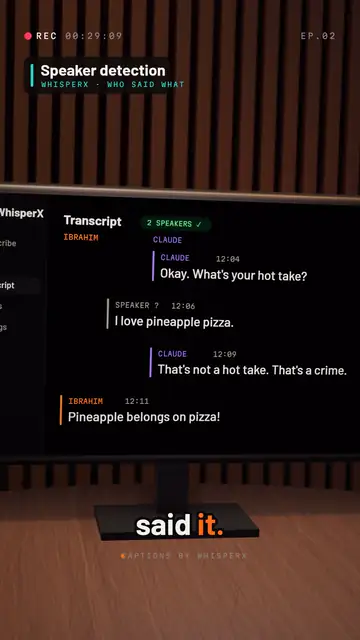</a>
<br>
<sub>▶ <b>Ep. 2: "I didn't say that"</b>: a cheap caption tool blamed the wrong host, and speaker detection set it straight · <a href="https://ibrahimqureshae.github.io/whisperx-transcriber/#podcast">watch it with sound</a></sub>
</div>

**04 · Find and export.** Search the transcript, then export SRT, VTT, TXT, JSON and more in one click.

<div align="center">
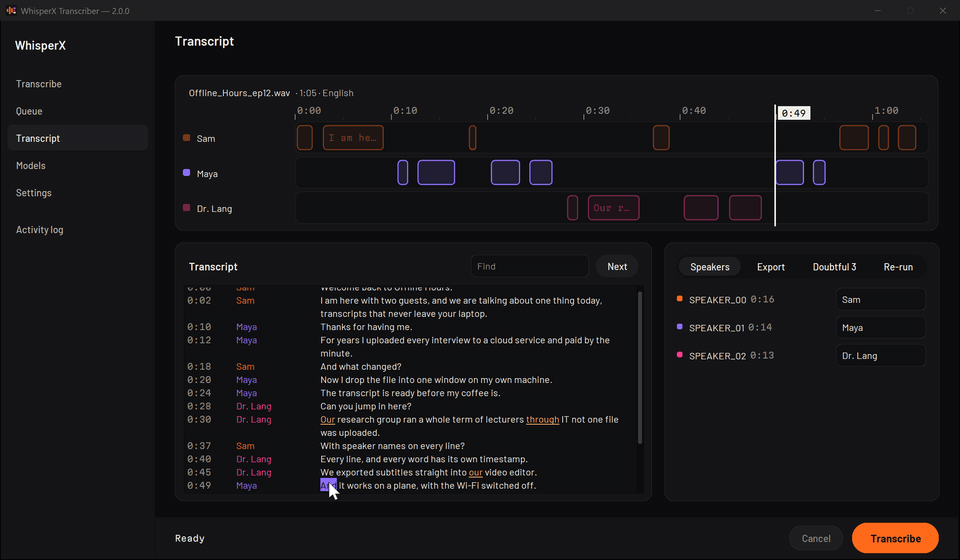
</div>

**05 · Any language, any direction.** Right-to-left transcripts read in the right order, with English words and numbers inside them kept intact.

<div align="center">
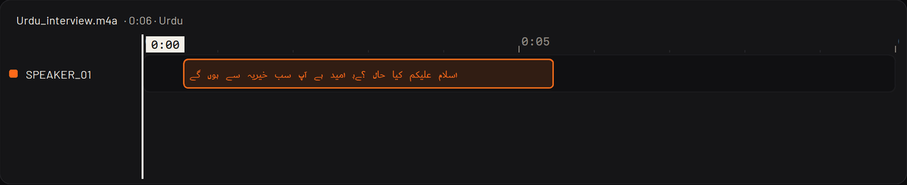
</div>

---

## How it compares to the WhisperX command line

WhisperX Transcriber is built on [WhisperX](https://github.com/m-bain/whisperX), the open speech engine behind word-level timestamps and fast batched transcription. WhisperX is a superb library. What this app adds is everything around it, so anyone can use it without touching a terminal.

<div align="center">
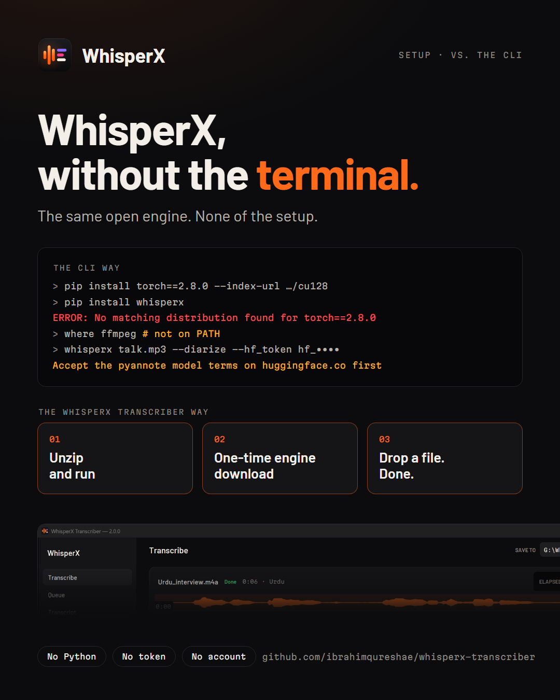
</div>

| | WhisperX command line | WhisperX Transcriber |
|---|:---:|:---:|
| Speech engine | WhisperX + faster-whisper | the same (built on WhisperX) |
| Install | Python, the right CUDA build of PyTorch, FFmpeg on PATH | unzip and run; the wizard picks GPU or CPU for you |
| Speaker identification | Hugging Face account, token and model terms | built in, downloads by itself, no account |
| Batch processing | write your own script | drag in files or a folder |
| Progress and cancel | log lines in a terminal | per-file progress, instant Cancel |
| Review the result | open the output files | speaker lanes, click-to-jump, Find, doubtful words |
| Speaker names in subtitles | edit the files by hand | type the name once |
| Right-to-left languages | raw text order | reads in the right order |

On the same model and settings the transcript is the same, because under the hood it is WhisperX. The point isn't to beat the engine. It's to make it usable by everyone.

<div align="center">
<sub>If WhisperX Transcriber sounds useful, consider ⭐ starring the repo. It helps other people find it.</sub>
</div>

---

## Getting started

**Requirements:** Windows 10 or 11 (64-bit). An NVIDIA GPU is optional; with driver 560 or newer the app uses it, otherwise it runs on the CPU.

**1. Download and run.** Get `WhisperXTranscriber.zip` from [Releases](https://github.com/ibrahimqureshae/whisperx-transcriber/releases/latest), extract it anywhere, and double-click `WhisperXTranscriber.exe`.

> **"Windows protected your PC"?** That's SmartScreen reacting to an unsigned build. Click **More info**, then **Run anyway**. The app is open source; code signing is on the [roadmap](#roadmap).

**2. First launch, once.** The setup wizard checks your GPU, installs Python if you don't have it, and downloads the speech engine. It takes 5 to 30 minutes depending on your connection, and only happens once.

**3. Transcribe.** Drop a file on the window (or press **Ctrl+O**), check the output formats, and press **Transcribe** (**Ctrl+Enter**). **Esc** stops a running job. Finished transcripts open on the **Transcript** screen.

<details>
<summary><b>Models</b>: which one to pick</summary>

Models download on first use and are cached on your disk. You can download and delete them on the **Models** screen.

| Model | Size | Best for |
|---|---|---|
| `large-v3-turbo` | ~1.6 GB | Near large-v3 accuracy, several times faster. Recommended on GPU |
| `large-v2` *(default)* | ~3 GB | Best quality |
| `large-v3` | ~3 GB | Latest Whisper large model |
| `medium` | ~1.5 GB | High accuracy |
| `small` | ~465 MB | Good balance on CPU |
| `base` | ~145 MB | Fast drafts |
| `tiny` | ~75 MB | Quick preview |
| `distil-large-v3` / `distil-large-v3.5` | ~1.5 GB | English-focused, fast |
| `distil-medium.en` / `distil-small.en` | ~800 / ~340 MB | English only, fastest |

</details>

<details>
<summary><b>Output formats</b></summary>

| Format | What you get |
|---|---|
| `srt` | Subtitles for VLC, YouTube, Premiere, DaVinci Resolve |
| `vtt` | WebVTT subtitles for web players |
| `txt` | Plain text |
| `tsv` | Start and end time per segment |
| `json` | Full segment JSON with all metadata |
| `word_json` | Per word: `{word, start, end, score}` |
| `aud` | Audacity label track |

Files are named after the audio (`<name>.srt`, `<name>_words.json`, `<name>.aud`). Speaker names replace the speaker labels in every export.

</details>

<details>
<summary><b>Languages</b></summary>

The model transcribes **99 languages**, and Auto-detect picks the language for you. The language menu lists English, Arabic, French, German, Spanish, Chinese, Japanese, Korean, Hindi, Pashto, Russian, Portuguese, Italian, Dutch, Polish, Turkish, Persian, Urdu and Georgian.

Word timestamps are available for all of those except Pashto, which gets segment timing.

</details>

<details>
<summary><b>Speaker identification</b></summary>

Turn on **Speakers** on the Transcribe screen. The first time, two small open models (about 34 MB) download by themselves. After that it runs offline, on the CPU. It uses [sherpa-onnx](https://github.com/k2-fsa/sherpa-onnx) (Apache-2.0), the pyannote segmentation model (MIT) and the WeSpeaker embedding model (Apache-2.0).

</details>

---

## Troubleshooting

**"Windows protected your PC"**: SmartScreen and an unsigned build. Click **More info**, then **Run anyway**.

**"An Application Control policy has blocked this file" (WinError 4551)**: open **Windows Security → App & browser control → Smart App Control settings**, switch it **Off**, and restart.

**Setup stopped mid-download**: click **Retry**. The wizard resumes and skips what is already installed.

**It installed the CPU engine on my NVIDIA PC**: update the NVIDIA driver to 560 or newer, then run setup again.

**CUDA out of memory**: the app already backs off on 8 GB cards. If it still fails, lower **Batch size** in Settings.

**Slow on CPU**: pick `small` or `base` on the Models screen.

**Anything else**: [open an issue](https://github.com/ibrahimqureshae/whisperx-transcriber/issues) and paste the **Activity log** from the sidebar. Bug reports genuinely help.

---

## Roadmap

- [ ] Code signing, to remove the SmartScreen warning
- [ ] Install with `winget`
- [ ] In-app transcript editing
- [ ] macOS and Linux builds

Open an issue if you want to shape it.

---

## For developers

<details>
<summary><b>Run from source, project layout and the CLI</b></summary>

You need Python 3.10 to 3.13 and Git. An NVIDIA GPU is recommended but not required.

```bash
git clone https://github.com/ibrahimqureshae/whisperx-transcriber.git
cd whisperx-transcriber
run.bat
```

`run.bat` (or `bash run.sh` on Linux and macOS) creates a `.venv`, detects your GPU, installs everything and launches the app.

```
whisperx-transcriber/
├── app.py / launcher.py    GUI entry points (source / packaged exe)
├── setup_wizard.py         First-run wizard
├── transcribe.py           Headless CLI
├── core/                   Pipeline, job queue, runner and settings; no GUI imports
├── ui/                     One module per screen, plus shared state, theme and waveform
├── packaging/              PyInstaller spec and build.bat
└── assets/                 Icon, fonts (Barlow, Martian Mono) and samples
```

The CLI takes the same options as the app:

```bash
python transcribe.py interview.mp3 --model large-v3-turbo --output srt --output txt
python transcribe.py lecture.m4a --language de --diarize --min-speakers 2 --max-speakers 4
python transcribe.py talk.mp4 --task translate --output srt --output-dir out --offline
```

Run `python transcribe.py --help` for the full list.

| Layer | Library |
|---|---|
| GUI | [customtkinter](https://github.com/TomSchimansky/CustomTkinter) |
| Transcription and alignment | [WhisperX](https://github.com/m-bain/whisperX) |
| Speech recognition | [faster-whisper](https://github.com/SYSTRAN/faster-whisper) on [CTranslate2](https://github.com/OpenNMT/CTranslate2) |
| Speakers | [sherpa-onnx](https://github.com/k2-fsa/sherpa-onnx) |
| Audio and video decoding | [FFmpeg](https://ffmpeg.org/) |
| Packaging | [PyInstaller](https://pyinstaller.org/) |

</details>

---

## Contributing

Contributions are genuinely welcome: bug reports, ideas, code, new languages, and testing on different hardware. See [CONTRIBUTING.md](CONTRIBUTING.md) to get a dev build running.

---

## Support the project

❤️ WhisperX Transcriber is free and MIT-licensed, and it will stay that way. If it saves you time or money, supporting it goes straight into the roadmap: code signing first, then winget and more platforms.

<p align="center">
  <a href="https://github.com/sponsors/ibrahimqureshae">
    
  </a>
  &nbsp;&nbsp;
  <a href="https://buymeacoffee.com/mibrahim99">
    
  </a>
  &nbsp;&nbsp;
  <a href="https://www.paypal.me/mibrahimqr">
    
  </a>
</p>

And starring the repo is free, which helps more than you'd think.

---

## Also by me

**[MDFlux](https://github.com/ibrahimqureshae/mdflux)**: turn any document into clean, AI-ready Markdown. Local-first, reads scanned PDFs, works offline.

---

## License

MIT. Free to use, modify, and distribute. See [LICENSE](LICENSE).

---

<div align="center">
Built on open-source foundations: <a href="https://github.com/m-bain/whisperX">WhisperX</a> · <a href="https://github.com/openai/whisper">OpenAI Whisper</a> · <a href="https://github.com/SYSTRAN/faster-whisper">faster-whisper</a> · <a href="https://github.com/k2-fsa/sherpa-onnx">sherpa-onnx</a> · <a href="https://github.com/TomSchimansky/CustomTkinter">customtkinter</a>

</div>
